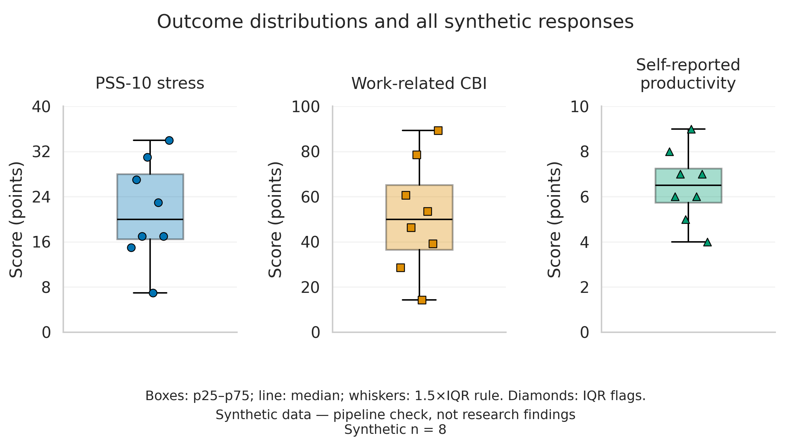

# Associations Between Remote IT Work Conditions, Stress, Burnout and Self-Reported Productivity

**Author:** Asanali Talgat  
**Research design:** quantitative, observational, cross-sectional survey  
**Repository:** https://github.com/Asanalishka/remote-it-wellbeing-study

**Research question:** How are remote-work conditions associated with stress and work-related burnout among IT specialists, and how are these outcomes related to self-reported productivity?

## Overview

This Week 6 pilot validates a small **synthetic** CSV, scores PSS-10 and the work-related subscale of the Copenhagen Burnout Inventory (CBI), reports data-quality indicators and descriptive means, and writes JSON output. It estimates the prespecified productivity models only when at least 80 complete, valid responses pass quality checks. The synthetic examples are not human-subject data and do not support research conclusions.

The optional visualization studio now adds cleaned CSVs, descriptive distributions, educational bootstrap intervals and three figures using the same eight fictional responses. **Synthetic data — pipeline check, not research findings.** This addition does not implement full-study hypothesis tests or RQ2 models.

The primary planned association is the adjusted coefficient for **10 additional CBI work-related burnout points** in a productivity model. RQ3 also requires the stress coefficient from that same full model: `productivity = intercept + beta_burnout * (CBI / 10) + beta_stress * PSS + covariates + error`. Covariates are age, years of experience, weekly hours, gender and job role. The baseline includes these covariates and stress; the full model adds burnout, so ΔR² represents burnout's additional contribution. Associations from a cross-sectional survey are not causal effects.

Aligned with Task 1, RQ1 describes outcome levels and plans secondary comparisons with mathematical scale midpoints (20, 50 and 5). RQ2 will model stress and burnout and compare adjusted predictions across **observed combinations of working hours, work-life balance, communication frequency and schedule flexibility**, after its protocol is finalized and real data are collected. Predictions do not establish a causal optimum and will not be extrapolated to unobserved work regimes. `remote_work_percent` describes the sample; it is not a regression covariate or one of the four RQ2 predictors.

The model formulas are fixed in `src/benchmark.py`. `config.json` controls input/output paths, instrument column mappings, quality thresholds and the confidence-interval multiplier (default `1.96` for an approximate two-sided 95% interval; retain this value for the documented output). When model estimation is enabled, `primary_model` retains all previous fields and adds `full_stress_beta_per_point`, `full_stress_beta_standard_error` and `full_stress_beta_approx_95pct_ci`. These describe stress per one PSS-10 point **after adjustment for burnout**. `baseline_stress_beta_per_point` remains available for comparison; it does not adjust for burnout.

## System requirements and quickstart

- Python **3.12.14** for the study environment. The original runner uses only the Python standard library; the optional studio has separate pinned dependencies.
- Clone or download the repository, then run these commands from its root directory:

```bash
python3 -m src.benchmark --config config.json --input data/sample/pilot_synthetic.csv --output results/pilot_summary.json
python3 -m unittest discover -s tests -v
```

The first command writes `results/pilot_summary.json` and prints `valid=8/8; model=not_estimated`. Expected JSON fields include `n_input: 8`, `n_valid: 8`, `n_rejected: 0`, `quality_pass: true`, `descriptive.remote_work_percent: 78.438`, and `primary_model.status: "not_estimated"`. Descriptive fields are means of valid records. With eight artificial records, model estimation is disabled by design. Invalid rows are listed with their CSV line numbers; a malformed header or empty file fails with a nonzero exit code. IDs are trimmed before duplicate detection; later valid rows with the same ID are rejected. The second command checks scale scoring, malformed input, remote-work percentages, quality gates, pilot output and recovery of both full-model coefficients with correlated predictors.

Docker quickstart (Docker Engine or running Docker Desktop required; commands below use a POSIX shell on macOS/Linux):

```bash
docker build -t remote-it-wellbeing-study .
mkdir -p results
docker run --rm --mount "type=bind,source=$(pwd)/results,target=/app/results" remote-it-wellbeing-study
```

The image pins Python `3.12.14-slim-bookworm` by tag and immutable multi-platform digest; it runs the same tests during build. The bind mount preserves `results/pilot_summary.json` on the host after the container exits. Only the configuration, source, tests and synthetic sample are copied into the image. The Docker CLI is unavailable in the local authoring workspace; [Pilot verification in GitHub Actions](https://github.com/Asanalishka/remote-it-wellbeing-study/actions/workflows/pilot.yml) builds the container, runs the tests and checks the persisted JSON on pushes and pull requests.

## Layout

```text
remote-it-wellbeing-study/
├── README.md, LICENSE, Dockerfile, .gitignore, .dockerignore
├── .github/workflows/pilot.yml   # original container check plus optional studio job
├── config.json                  # thresholds, variable mappings and paths
├── requirements-studio.txt      # pinned optional plotting/processing dependencies
├── requirements-notebook.txt    # Jupyter execution dependencies
├── docs/methodology-card.md    # hypothesis, variables, baseline and validity
├── docs/completed-survey-codebook.md  # rules for the administered form
├── docs/domain_model.md         # equations and notation for the survey
├── data/sample/pilot_synthetic.csv  # eight fictional responses only
├── data/sample/completed_survey_synthetic.csv  # legacy eight-row fictional fixture
├── data/sample/completed_survey_synthetic_75.csv  # 75 fictional completed-form responses
├── data/processed/             # allowlisted synthetic tables and quality report
├── src/benchmark.py            # shared loader, scale scoring and baseline model
├── src/analyze_survey.py       # real/synthetic labels and as-administered scoring
├── src/execute_notebook.py     # run and validate the analysis notebook
├── src/render_survey_report.py # regenerate the Results & Discussion draft
├── src/process_data.py         # descriptive statistics, IQR flags and bootstrap
├── src/visualize.py            # headless PDF/PNG figure export
├── tests/test_benchmark.py     # standard-library pilot tests
├── tests/test_analyze_survey.py # completed-form schema and provenance checks
├── tests/studio/               # optional processing and figure tests
├── reports/figures/            # three synthetic figures in PDF and PNG
├── reports/paper_section_4.md  # interim Results & Discussion draft
├── notebooks/01_data_analysis.ipynb  # executed descriptive notebook
└── results/                    # private generated JSON/CSV ignored by Git
```

## Synthetic data processing and visualization studio

Use this workflow only with fictional survey responses. Its outputs are explicitly marked as synthetic; `--input` supports other **synthetic** test fixtures, not real participant data. The original sample is never modified. All paths below are relative to the repository root.

### 1. Install, validate and summarize

Use Python 3.12.14 for the documented study environment. The initial local studio artifacts were generated and tested with Python 3.14.8; their exact runtime is recorded in the quality report. CI is configured to run the studio on Python 3.12.14. The pinned studio dependencies require Python 3.12 or newer; the macOS system Python 3.9 is not sufficient for this optional workflow.

```bash
python3.12 -m venv .venv
.venv/bin/python -m pip install -r requirements-studio.txt
.venv/bin/python -m src.process_data \
  --config config.json \
  --input data/sample/pilot_synthetic.csv \
  --output-dir data/processed
```

The shared loader checks required and duplicate columns, missing values, finite numbers, instrument ranges, plausible experience and unique trimmed IDs. PSS-10 and CBI reuse the original reverse-scoring functions. A duplicate is rejected after the first valid occurrence. Missing responses are not imputed. Extra row fields are rejected; errors retain CSV line numbers.

Expected result: **8 input, 8 valid, 0 rejected; rejection rate 0%; quality guardrail passes; no model estimated.** Rejection rate always uses all input questionnaires as its denominator. Reporting exclusions makes them visible but does not eliminate selection bias.

| Artifact in `data/processed/` | Contents |
| --- | --- |
| `cleaned_responses.csv` | All valid responses, scored outcomes, one IQR flag per outcome, synthetic notice |
| `metrics_summary.csv` | Three outcome rows: n, mean, sample SD, p25/p50/p75/p95/p99, mean CI, IQR fences and flagged counts |
| `quality_report.json` | Counts and rejection reasons, guardrail status, provenance hashes, runtime versions and statistical settings |

For each outcome, a value is flagged if it lies strictly outside `p25 − 1.5 × IQR` to `p75 + 1.5 × IQR`, where `IQR = p75 − p25`. These flags never remove valid responses from statistics or plots. With zero IQR, values different from the common quartile value may still be flagged. None of the current eight responses is flagged.

SD uses `ddof=1`. Quantiles use linear interpolation. The bootstrap draws whole respondent rows with replacement, preserves their paired outcomes, computes means for 10,000 resamples and takes the 2.5th and 97.5th percentiles. It uses NumPy PCG64 with seed 42. These **educational 95% intervals** demonstrate the algorithm; they do not quantify evidence about real IT workers. SD and IQR describe response spread; a CI describes uncertainty in an estimated mean under sampling assumptions. Neither p25–p75 nor SD is a 95% CI. The p95 and p99 columns satisfy the exercise but are unstable with eight observations.

One valid response yields blank SD/CI fields and `ci_status=unavailable_n_lt_2`. Zero valid responses or a malformed CSV schema produces a failed quality report and a nonzero exit; plotting refuses failed reports. With valid rows but more than 10% rejected, descriptive output is retained and figures display a failed-guardrail notice. The studio does not fit models; the original runner retains its 80-case gate.

Re-running with identical data, settings and the same environment reproduces the tables. SHA-256 hashes identify the input, configuration and output CSVs; plotting rejects CSVs that do not match the report. Dependency versions are pinned in `requirements-studio.txt`; Python and core library versions are also recorded in the report. PDF/PNG bytes are not promised to match across operating systems, fonts or library builds.

### 2. Generate and audit figures

```bash
.venv/bin/python -m src.visualize \
  --input-dir data/processed \
  --output-dir reports/figures
```

| Figure stem | Interpretation |
| --- | --- |
| `means_ci` | Three separate panels: means and precomputed educational 95% bootstrap intervals |
| `distributions` | Separate box plots with all eight points; p25–p75 boxes, median lines, whiskers to the most extreme observations within 1.5×IQR fences; diamonds mark flagged observations if present |
| `burnout_productivity` | CBI versus self-reported productivity; each point is one fictional respondent, with no regression or association inference |

Each stem is exported as a vector PDF with embedded TrueType fonts and as a 300 DPI PNG. English figure labels match the paper's terminology. The shared style uses Seaborn `whitegrid`, paper context, `font_scale=1.2` and the `colorblind` palette. Circle, square and triangle markers distinguish outcomes independently of hue. Separate panels prevent confusion between different score ranges. Horizontal offsets in the box plots only separate overlapping points; they encode no variable.



Plot audit at the native 7.5-inch figure width:

- [x] Outcomes and axes identify the variables and point units; full bounded scales are 0–40, 0–100 and 0–10, with limited tick density and no logarithmic scale.
- [x] Mean intervals are labeled as educational bootstrap CIs; distribution boxes describe IQR, not CI. The scatter plot makes no inferential claim requiring a fitted-model interval.
- [x] Panel titles, distinct markers, black outlines and median lines preserve meaning in grayscale. Synthetic-data notices appear on every figure.

Figures are intended for full-width placement; recheck label sizes if reducing them to a single paper column. A reusable style is provided by `set_theme()` in the visualization module. References for the implementation: [Seaborn theme settings](https://seaborn.pydata.org/generated/seaborn.set_theme.html), [Pandas quantile interpolation](https://pandas.pydata.org/docs/reference/api/pandas.Series.quantile.html), and [NumPy random generators](https://numpy.org/doc/stable/reference/random/generator.html).

### 3. Verify the complete workflow

```bash
.venv/bin/python -m unittest discover -s tests -v
.venv/bin/python -m unittest discover -s tests/studio -v
.venv/bin/python -m src.benchmark --config config.json --input data/sample/pilot_synthetic.csv --output results/pilot_summary.json
.venv/bin/python -m src.process_data
.venv/bin/python -m src.visualize
```

The original 17 tests remain independent of optional dependencies. Ten additional studio tests cover scale compatibility, known summary values, retained outliers, bootstrap reproducibility, single/constant samples, rejection denominators, failed runs, mismatched artifacts, figure labels/bounds, all plotted points, PDF headers and PNG resolution. CI has a separate studio job and retains the existing container job. The container continues to run only the standard-library pilot.

### Mapping the supplied studio assignment

| Original requirement | Survey adaptation / applicability |
| --- | --- |
| JSONL ingestion | Existing CSV; shared schema validation followed by Pandas processing |
| Warm-up filtering | Not applicable: no phase field or warm-up observations |
| HTTP 429/500/504 and runtime errors | Questionnaire rejection counts/reasons and explicit processing failures; no HTTP statuses exist |
| Non-destructive noise detection | Outcome IQR flags; no claim that extreme answers are hardware noise |
| Latency/throughput summaries | PSS-10, CBI and productivity summaries, including requested tail percentiles |
| CI across independent runs | Educational resampling of respondent rows; independent benchmark runs do not exist |
| Metric versus workload line plot | CBI/productivity scatter; RPS and workload experiments do not exist, and joining respondents would imply an unsupported sequence |
| Algorithms/baseline distribution comparison | Separate outcome box plots with every synthetic observation; no algorithm groups or invented comparison groups |
| CI bands, bar caps, percentile bands | Capped mean intervals plus separate IQR boxes; no line/bar chart is needed, and aggregate CSVs are not bootstrapped again |
| Zero/log scales and physical units | Full bounded score axes in points; logarithmic scaling is unnecessary and would exclude valid zeros |
| Colorblind palette and grayscale line styles | Colorblind palette, different markers, panel labels and black outlines; line styles are not applicable to these point/box plots |
| PDF/PNG and reproducibility | Three PDFs, three 300 DPI PNGs, pinned dependencies, seed and provenance report |
| Final audit and Git workflow | Checklist above and explicit local Git commands below; no automatic commit or push |

No full-study RQ1/RQ3 tests, RQ2 modeling, new recruitment data or research conclusions are included.

### Optional local Git commands

Only the three named synthetic data artifacts and six named figures are allowlisted; other files under those output directories remain ignored. This allowlist is not a privacy filter: never replace these files with real responses. Review the diff before committing. These commands are provided for manual use and are not run by the studio; no push is included.

```bash
git add README.md .gitignore .github/workflows/pilot.yml requirements-studio.txt \
  src/benchmark.py src/process_data.py src/visualize.py tests/studio/test_studio.py \
  data/processed/cleaned_responses.csv data/processed/metrics_summary.csv data/processed/quality_report.json \
  reports/figures/means_ci.pdf reports/figures/means_ci.png \
  reports/figures/distributions.pdf reports/figures/distributions.png \
  reports/figures/burnout_productivity.pdf reports/figures/burnout_productivity.png
git diff --cached --stat
git diff --cached --check
git diff --cached
git commit -m "Add synthetic survey processing and publication-style figures"
```

## Planned evaluation

| Stage | Metric | Baseline / comparison | Output |
| --- | --- | --- | --- |
| Week 6 pilot | Valid rows; rejected-row rate; mean PSS-10 (0–40), work CBI (0–100), productivity (0–10) and remote-work percentage (>0–100) | Scoring rules and input ranges | `results/pilot_summary.json`; no sample inference |
| Full study RQ1 | Outcome distributions; secondary comparisons of means with 20, 50 and 5 | Mathematical scale midpoints, not clinical norms | Three two-sided tests with Holm adjustment; Week 7 implementation |
| Full study RQ2 | Adjusted associations and predicted stress/burnout across observed combinations of hours, balance, communication and flexibility | Models controlling for age, gender, experience and role | Regression and prediction summaries; Week 7 implementation |
| RQ3 estimation | Primary: burnout beta per 10 points; required secondary: full-model stress beta per PSS point; approximate 95% intervals; change in R² | Covariates + stress versus covariates + stress + burnout, on identical cases | Implemented; only if quality and sample gates pass |
| Full study RQ3 inference | Negative stress and/or burnout association in the full model | H0: both coefficients nonnegative; H1: at least one negative | Two one-sided tests with Holm adjustment; Week 7 implementation |

**Guardrails:** rejection rate at most 10%; at least 80 complete cases before model estimation; finite bounded responses and unique respondent IDs. The 80-case gate is a provisional engineering safeguard, **not** a power calculation. A final sample-size and sensitivity plan should be specified before recruitment. The current confidence interval uses classical OLS standard errors and needs diagnostic checks on real responses.

**Inference boundary:** the planned three two-sided RQ1 tests and two one-sided RQ3 tests use Holm adjustment in separate families, each at family-wise α = 0.05. The pilot reports approximate two-sided 95% intervals without multiplicity adjustment; it implements neither family of tests and claims no significance. Burnout's primary reporting status does not remove stress from RQ3 or bypass the two-test adjustment. Before recruitment, finalize sample-size justification, missing-data handling, individual test methods, the RQ2 testing/prediction protocol, and questionnaire/eligibility rules. Full distributions, hypothesis tests and RQ2 estimation remain Week 7 work.

## Data and instrument notes

### Completed survey export

The already administered Google Form differs from the synthetic pilot schema: communication is categorical, flexibility and work-life balance use 1–5 ratings, and CBI has four combined response options scored 100/75/25/0. The real-export workflow preserves these choices and labels burnout as an **adapted CBI work score**. It does not pretend the missing 50-point option was offered to respondents. See the [completed-survey codebook](docs/completed-survey-codebook.md).

Run the aggregate analysis against the original CSV or a ZIP containing one CSV, with output under ignored `results/`:

```bash
python3 -m src.analyze_survey --input '/path/to/original-export.csv.zip' --output results/survey_summary.json
```

For a labeled 5-real/75-synthetic table using the **same as-administered questionnaire rules** for both groups:

```bash
python3 -m src.analyze_survey \
  --input '/path/to/original-export.csv.zip' \
  --synthetic-input data/sample/completed_survey_synthetic_75.csv \
  --output results/survey_comparison.json \
  --records-output results/survey_records_labeled.csv
```

`origin` marks each row as `real` or `synthetic`; the comparison JSON reports each group separately. It does not pool their statistics. The 75 fictional rows are reproducibly generated with `python3 -m src.generate_synthetic_75` (seed 42), without using the human export. The two earlier eight-row synthetic files remain legacy pipeline fixtures. Five real plus 75 fictional rows do **not** make an 80-person research sample.

The input is read without modification. The output contains counts, validation reasons, descriptive statistics and review flags, but no individual answers or timestamps. Recruitment and response collection took place on 3–4 November 2026 through former colleagues and friends, according to the study owner. Collection is closed and no further responses are expected. The final private export contains five eligible, valid records and no rejected answers. Its mean PSS-10 is 18.20, mean adapted CBI work score is 23.57, and mean self-rated productivity is 7.40. One unusual experience/age combination and one report of 100 weekly working hours are flagged; the study owner chose to retain both answers unchanged. This convenience sample and the flagged values limit interpretation. The report does not estimate association models or run hypothesis tests. The categorical RQ2 predictor needs a prespecified model before RQ2 estimation. Real exports and any derived respondent-level files must stay outside the public repository.

### Preliminary Task 3 artifacts

The [domain model](docs/domain_model.md) defines the as-administered scoring and grouped statistics. The [executed notebook](notebooks/01_data_analysis.ipynb) reads `data/raw/survey_export.csv.zip` when available locally; this raw-data directory is ignored by Git. Without that file, it runs the public synthetic fixture only. Notebook cells display aggregates, not individual records. The [Results & Discussion draft](reports/paper_section_4.md) is generated from the grouped report and reports the five real responses descriptively. Its [real-response figure](reports/figures/real_survey_outcomes.png) also has a [vector PDF](reports/figures/real_survey_outcomes.pdf); points show means and bars show sample SD, not confidence intervals.

When a newer export becomes available, replace the ignored `data/raw/survey_export.csv.zip` and refresh the artifacts from the repository root:

```bash
.venv/bin/python -m src.analyze_survey \
  --input data/raw/survey_export.csv.zip \
  --synthetic-input data/sample/completed_survey_synthetic_75.csv \
  --output results/survey_comparison.json \
  --records-output results/survey_records_labeled.csv
.venv/bin/python -m src.execute_notebook
.venv/bin/python -m src.render_survey_report
```

Install the notebook dependencies from `requirements-notebook.txt` if needed. Jupyter uses a local kernel socket. The notebook's real-only PDF/300-DPI PNG aggregate figure is written under `reports/figures/`; a separate real/synthetic comparison figure stays in ignored `results/figures/`. The current notebook was executed with Python 3.14.8 and all five code cells completed without errors. Recruitment and collection are closed at five real responses; these support descriptive reporting only. The 75 fictional responses do not increase the inferential sample size.

- **Synthetic pilot input format:** `remote_work_percent` is required. It means the self-reported percentage of working hours performed remotely in a usual working week; finite values must be greater than 0 and at most 100, with fractions allowed. All eight sample values are fictional. CSVs without this column fail clearly; no value is imputed. A days-per-week field is not required and is not accepted as a substitute. Days cannot be converted into hour percentages without information about working-day lengths.
- PSS-10 items `pss_01..pss_10` are numeric 0–4. Items 4, 5, 7 and 8 are reverse coded. Sum ranges from 0 to 40. [Original scoring instructions](https://www.cmu.edu/dietrich/psychology/stress-immunity-disease-lab/scales/html/pssscoring.html).
- In the synthetic pilot, work-related CBI items `cbi_01..cbi_07` are entered as 0–4 from least to most frequent/intense, multiplied by 25 and averaged; item 7, about energy for family and friends, is reversed. The first three and last four questions have different verbal anchors in the [original instrument](https://nfa.dk/media/a4wheblj/cbi-scales.pdf). The completed survey used a different four-answer form; use the adapted scoring documented above for its responses.
- `productivity_0_10` is a single, explicitly self-reported rating. It is not an objective measure of software output and has not been validated as a stand-alone scale.
- Real survey responses must be collected with appropriate consent, stored outside the public repository, and analysed only in de-identified form. The included CSV is fictional.

## Citation and license

Study protocol: Talgat, A. (2026). *Associations Between Remote IT Work Conditions, Stress, Burnout and Self-Reported Productivity* (course project; methodology passport and pilot pipeline).

PSS-10: Cohen, S., Kamarck, T., & Mermelstein, R. (1983), *Journal of Health and Social Behavior*, 24(4), 385–396.  
CBI: Kristensen, T. S., Borritz, M., Villadsen, E., & Christensen, K. B. (2005), *Work & Stress*, 19(3), 192–207.

Code is released under the [MIT License](LICENSE). The license does not override permissions for third-party questionnaires; check questionnaire permissions before distributing survey materials.
