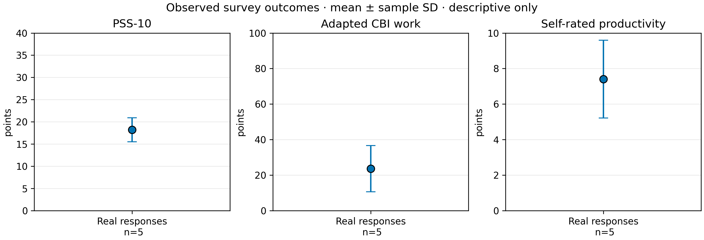

# 4. Results & Discussion

> **Small-sample descriptive report: no population inference.** Real and synthetic questionnaires use the same validation and scoring rules, but are reported as separate groups. Synthetic records are not participants and are never included in a pooled estimate.

## 4.1 Data provenance and quality

Recruitment and response collection took place on **3–4 November 2026** among former colleagues and friends, according to the study owner. Collection is closed; no further responses are expected. This convenience sample limits generalizability. The final export contains 5 submitted rows. Of these, 5 met the two eligibility questions, 0 eligible rows were rejected for missing or invalid answers, and **5 real questionnaires** were valid for descriptive analysis. The two review-flagged answers (experience_exceeds_age_minus_16_review: 1, weekly_hours_ge_80_review: 1) were retained as reported at the study owner's direction; their values were not corrected or silently excluded. Consent was obtained before the substantive questions, according to the study owner. The source export is stored privately and is not part of the public repository.

The separate fictional fixture contains 75 valid records generated with a fixed seed. It verifies the same question formats and scoring code but contributes no evidence about IT workers. **5 real + 75 synthetic is not a research sample of 80.**

## 4.2 Real responses

**Table 1. Descriptive outcomes for real respondents.** SD is the sample standard deviation of observed answers, not a confidence interval. CBI is an adapted four-answer work score. Values are rounded to two decimals; calculations use unrounded scores.

| Outcome | n | Mean ± SD | Median | Min–max | Scale |
| --- | ---: | ---: | ---: | ---: | --- |
| PSS-10 | 5 | 18.20 ± 2.68 | 17.00 | 16.00–22.00 | 0–40 points |
| Adapted work CBI | 5 | 23.57 ± 13.03 | 17.86 | 10.71–39.29 | 0–100 points |
| Self-rated productivity | 5 | 7.40 ± 2.19 | 8.00 | 4.00–10.00 | 0–10 points |

Communication frequency was recorded categorically: Несколько раз в день: 5. The questionnaire does not supply an exact weekly contact count. Work-life balance and schedule flexibility retain their original 1–5 scales.

**Figure 1. Descriptive outcomes in the 5 real questionnaires.** Panels show PSS-10 (0–40 points), adapted work CBI (0–100 points), and self-rated productivity (0–10 points). Points are sample means; capped bars show ±1 sample SD, the spread of observed responses, **not** 95% confidence intervals. With this sample, the figure does not support population claims.

 ([vector PDF](figures/real_survey_outcomes.pdf))

## 4.3 Synthetic pipeline check

**Table 2. Fictional answers used only to verify the analysis pipeline.** These rows were generated independently of the human answers with a fixed seed and the completed form's answer options. They must not be compared as a treatment or baseline group.

| Outcome | n | Mean ± SD | Median | Min–max | Scale |
| --- | ---: | ---: | ---: | ---: | --- |
| PSS-10 | 75 | 21.28 ± 4.96 | 21.00 | 11.00–33.00 | 0–40 points |
| Adapted work CBI | 75 | 50.86 ± 14.06 | 53.57 | 17.86–82.14 | 0–100 points |
| Self-rated productivity | 75 | 5.47 ± 2.93 | 5.00 | 0.00–10.00 | 0–10 points |

The executed notebook also produces a local comparison figure at `results/figures/survey_outcomes_by_origin.pdf` and `.png`. Blue circles mark real aggregates and orange squares mark synthetic demonstration aggregates; these sources are never pooled. This comparison figure is kept outside the public report to avoid treating fictional responses as a study baseline.

## 4.4 Interpretation and limitations

The RQ3 model was not estimated: requires >= 80 valid answers and passing quality checks. The RQ2 model is also not estimated because communication is an ordered category and its model specification is unfinished. With 5 real answers, these summaries describe only the observed respondents; they do not establish population differences, associations, or causal effects. The adapted CBI form used four combined response options scored 0, 25, 75, and 100; its values are not directly interchangeable with the original five-category CBI scale. Self-reported productivity is not an objective measure of work output.

The closed sample contains 5 real questionnaires. The review-flagged answers have been retained by decision, but their plausibility remains a limitation. The methodology and equations are in [`docs/domain_model.md`](../docs/domain_model.md) and [`docs/completed-survey-codebook.md`](../docs/completed-survey-codebook.md).
